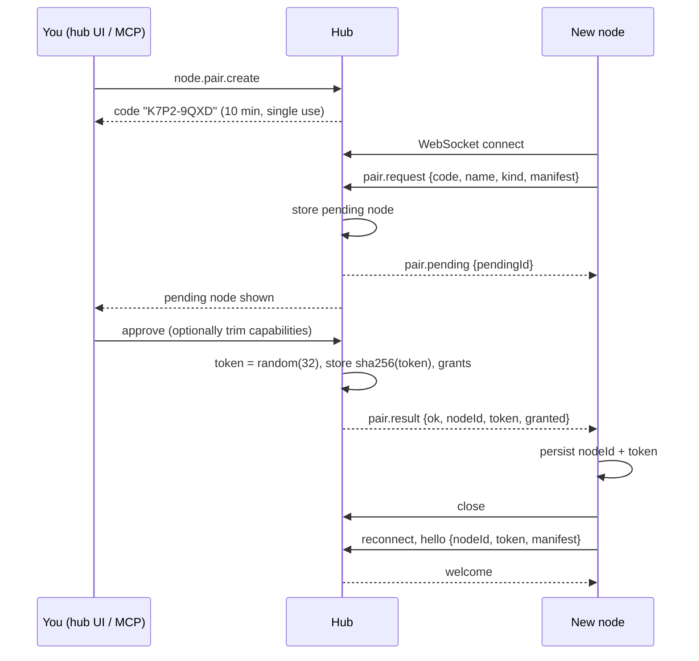
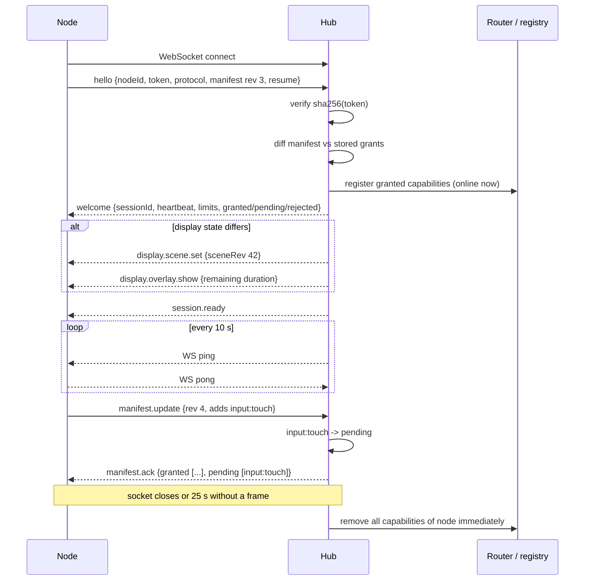
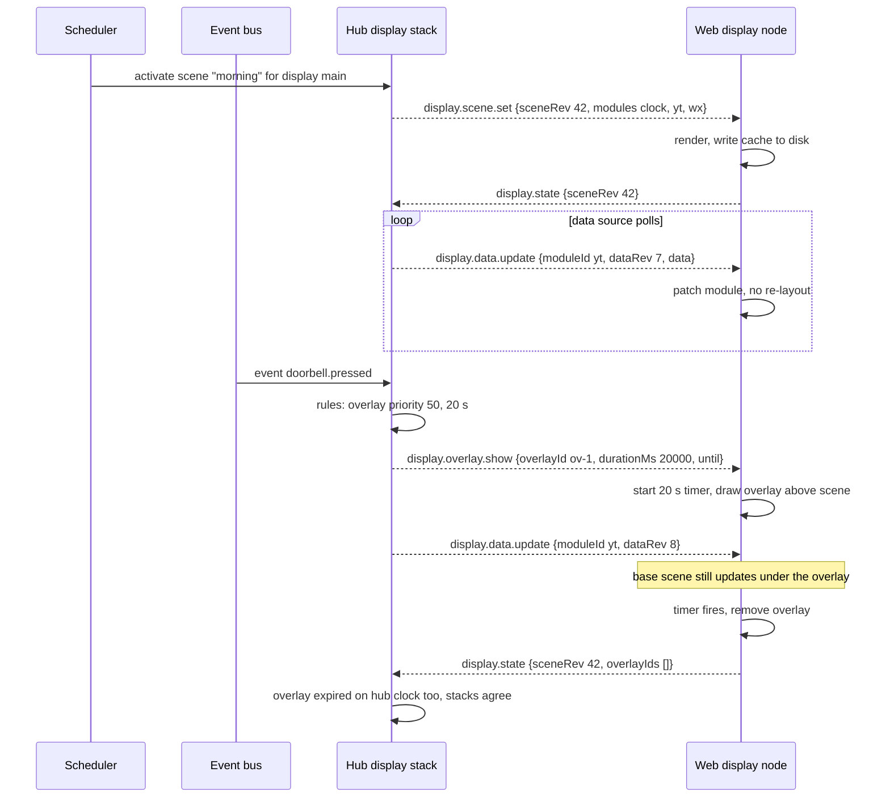
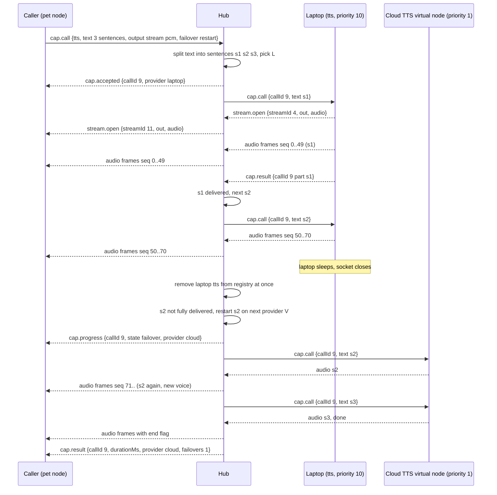
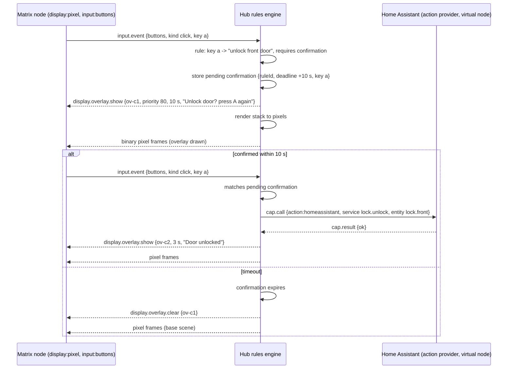

# Proposal 001: Wire protocol draft

- Status: Draft
- Source: "Teletron Wire Protocol v1", Draft 1, made with Claude Fable (claude.ai artifact)
- Date added: 2026-11-08
- Used by: slice 1, PR 1 (protocol envelope), and later slices
- Change from the source: headings moved down two levels. The content is unchanged.

## How to use this proposal

The proposal was written before some ADRs. The ADRs win. The slice 1 spec decides each conflict below. Do not change the proposal text. Record decisions in the spec or in a new ADR.

## Parts that agree with the ADRs

Use these parts as written, unless a spec says otherwise:

- Envelope with `v`, `type`, `id`, `ref`, `ts` and `body`. Unknown fields are ignored. Minor versions are additive (section 1).
- JSON for control messages and raw binary WebSocket frames for audio and blobs (section 1.4).
- Connection states, heartbeat with protocol pings and a JSON ping for browsers, reconnect with backoff, close codes (section 2).
- Resume as a replay of the current state, with revisions on scenes and data (section 2.6, ADR-005).
- The node caches the scene and shows an offline marker. It never blanks (section 2.6, ADR-020).
- The node proposes capabilities, the hub grants them. A manifest cannot grant permissions (section 3.2, ADR-007).
- Virtual nodes for cloud services with the same manifest shape (section 3.1).
- Scene revisions, data revisions, overlays with node-side expiry and a hub-owned priority stack (section 4, ADR-029).
- Capability calls with streams, cancellation, progress and failover between online providers only (section 6, ADR-011).
- The hub in the middle of every stream (section 6.7).
- Error codes and per-class backpressure (section 7).
- All secrets stay on the hub (section 11, question 3).

## Conflicts with the ADRs

| #   | Proposal                                                                                                                       | ADR                                                                                                                                    | Proposed resolution for the spec                                                                                                                                     |
| --- | ------------------------------------------------------------------------------------------------------------------------------ | -------------------------------------------------------------------------------------------------------------------------------------- | -------------------------------------------------------------------------------------------------------------------------------------------------------------------- |
| 1   | Plain `ws://` on the LAN, Tailscale for remote nodes, no TLS (sections 0, 11).                                                 | ADR-002, ADR-006: hub on a VPS, `wss://` through Caddy with Let's Encrypt.                                                             | Use `wss://`. Tokens stay as they are. Remove the Tailscale assumption.                                                                                              |
| 2   | The hub renders pixel frames. `display:pixel` nodes only blit. The ESP32 section depends on this (sections 1.2, 4.4, 9.5, 10). | ADR-023: rendering on nodes only, no raw frames in v1.                                                                                 | Remove the `pixels` binary kind and `display.frames.*`. See rows 15 and 16.                                                                                          |
| 3   | Pairing with an 8-character code, a pending node and approval on the hub (section 2.2).                                        | ADR-007: create the node on the hub through MCP or the CLI. The hub shows the token one time.                                          | Use the ADR-007 flow. Drop `pair.request`, `pair.pending` and `pair.result`. The token goes into the node config by hand.                                            |
| 4   | Node IDs are UUIDv4 strings. The protocol does not say what happens when two connections use the same token.                   | ADR-008: a node is a name. The newest connection wins, the hub closes the old one and logs it.                                         | Add a node name to `hello` and `welcome`. Add a close code for "replaced by a newer connection". Do not reconnect on that code.                                      |
| 5   | Capabilities are `family:kind` plus `instance`.                                                                                | ADR-009: addressable instances such as `livingroom-pi/hdmi`.                                                                           | Define the address as `<node name>/<instance>`. Keep `family:kind` as the type.                                                                                      |
| 6   | Routing uses one priority number for each grant.                                                                               | ADR-012: cost, quality tier and location, request hints, hard requirements.                                                            | Add `cost`, `quality` and `location` to manifest capabilities, and `hints` and `require` to `cap.call`. Needed only in slice 8.                                      |
| 7   | No local-only capabilities.                                                                                                    | ADR-013: local-only or shared.                                                                                                         | Add a `scope` field (`local` or `shared`) to manifest capabilities.                                                                                                  |
| 8   | Bridges are not in the protocol. Home Assistant is an `action` virtual node (section 9.5).                                     | ADR-016, ADR-017, ADR-018: bridge nodes announce catalogs, values stream only when subscribed, local allowlist, HA as an add-on node.  | Add catalog, subscribe, unsubscribe and value messages in slice 7. HA becomes a real node, not a virtual node.                                                       |
| 9   | No message for a node that pushes source values.                                                                               | ADR-015: pushed values are sources.                                                                                                    | Add a source value message from node to hub. Can share the shape with bridge values (row 8).                                                                         |
| 10  | Confirmation is a rules-engine overlay plus the next matching input (sections 5, 9.5).                                         | ADR-031: a pending confirmation with an ID and a short expiry goes back to the originating client. The client asks in its own way.     | Add `confirm.request` (hub to client) and `confirm.response` (client to hub). The client draws its own prompt.                                                       |
| 11  | No person in calls or sessions.                                                                                                | ADR-037, ADR-039: memory and access depend on the person.                                                                              | Add an optional `person` to `cap.call` and to assistant sessions. Needed in slice 9.                                                                                 |
| 12  | The voice loop goes through the hub. The rules engine decides the reply (section 5).                                           | ADR-035, ADR-052: the voice loop runs on the node and calls STT, LLM and TTS through the router. Each character has its own wake word. | The node is the caller of `stt`, `llm` and `tts`. Keep `input.event` voice kinds for triggers only, with the character that the wake word names.                     |
| 13  | Free module `type` and `spec`, a grid layout, and an optional `rendererUrl` with JS from the hub (sections 4.1, 11).           | ADR-021, ADR-022: fixed component library, a separate layout for each target type.                                                     | Slice 1 PR 2 defines the module spec. `display.scene.set` carries the layout for the target type of the node. Renderer code ships with the node, not with the scene. |
| 14  | Images go as `blob` streams.                                                                                                   | ADR-025: assets on the hub, addressed by content hash, cached on nodes.                                                                | Add an asset fetch by hash in slice 5. Keep `blob` streams for call outputs.                                                                                         |
| 15  | The ESP32 pixel node (section 10) and the C++ client.                                                                          | ADR-051: there is no ESP32.                                                                                                            | Remove section 10 from the spec.                                                                                                                                     |
| 16  | Live pixel frame streaming to the matrix (sections 1.2, 4.4).                                                                  | ADR-051: the iPixel Color panel takes pre-rendered GIF loops and images from a Pi over Bluetooth.                                      | Row 2 is now settled: no `pixels` binary kind and no `display.frames.*`. The Pi node drives the panel locally.                                                       |
| 17  | TTS output is audio only.                                                                                                      | ADR-053: lip sync uses visemes when the TTS provider gives them.                                                                       | Add an optional viseme channel to the TTS output, for example `cap.chunk` items with time and viseme.                                                                |

## Reuse-vs-build notes

The proposal chooses `ws` as the only runtime dependency of the hub and hand-written validation. Record this in the reuse-vs-build ADR for slice 1 (ADR-040).

## Proposal

### Teletron Wire Protocol v1

Status: Draft 1. Scope: home project, not production grade. Shortcuts are marked with "Shortcut:".

Audience: you, in two years, with a new node to write.

#### 0. Assumptions

- One hub. Nodes dial in to `ws://hub:PORT/ws` over the LAN or Tailscale.
- Transport is plain `ws://`. Per-node tokens give authentication. Tailscale gives transport privacy for remote nodes. There is no TLS in v1.
- All text messages are JSON (UTF-8). All binary WebSocket frames carry a small fixed header followed by raw bytes (pixels, audio).
- Pixel frames are raw RGB values. The node declares which pixel formats it accepts. The hub picks one. Dirty-rect partial frames are optional and declared by the node.
- Clocks: the hub clock is the reference. Nodes do not need a correct clock. The hub stamps every message it creates; nodes stamp with their best clock (uptime is acceptable).
- After a hub restart the hub restores for each node: the current scene, active overlays and in-flight capability calls. The hub does not replay missed events. Events are "latest state wins".
- The hub is the only router. A node never talks to another node directly. A capability call always goes caller -\> hub -\> provider.
- Node IDs are UUIDv4 strings that the hub issues at pairing. Capability IDs are `family:kind` strings, for example `display:pixel`.
- The hub side and Node-capable nodes are TypeScript. The single runtime dependency on the hub is `ws`. Validation is hand-written (see `src/validate.ts`).

#### 1. Message envelope

##### 1.1 Text messages (JSON)

Every text frame is one JSON object with this envelope:

```json
{
  "v": 1,
  "type": "cap.call",
  "id": "01J...",
  "ref": "01J...",
  "ts": 1762516800123,
  "body": {}
}
```

| Field  | Type   | Required | Meaning                                                                                         |
| ------ | ------ | -------- | ----------------------------------------------------------------------------------------------- |
| `v`    | number | yes      | Protocol major version. v1 is `1`.                                                              |
| `type` | string | yes      | Message type, dotted. The first segment is the namespace.                                       |
| `id`   | string | yes      | Unique message ID. ULID or UUID. Nodes with tight memory may use `"<nodeShortId>-<counter>"`.   |
| `ref`  | string | no       | ID of the message this one answers or relates to. Replies, acks, errors and progress set `ref`. |
| `ts`   | number | yes      | Sender timestamp, Unix milliseconds. Nodes without a clock send uptime milliseconds.            |
| `body` | object | yes      | Type-specific payload. Empty object when there is nothing to send.                              |

Rules:

- Unknown `type`: the receiver replies `error` with code `UNKNOWN_TYPE` for request types, and silently ignores it for event types. Event types end in `.event`, `.update`, `.state` or `.ack`.
- Unknown fields in `body`: ignore. This is how we add fields without a major bump.
- Max JSON message size: 64 KiB by default. A node can lower this in its manifest (`limits.maxJsonBytes`). The hub must respect it.
- `ref` on a request is unset. `ref` on a reply points to the request. Streams and long calls use `callId` or `streamId` in the body, not `ref`, because one request can produce many messages.

##### 1.2 Binary frames

Binary WebSocket frames carry bulk data. Layout (little-endian):

    offset  size  field
    0       1     magic      0x54 ('T')
    1       1     version    1
    2       1     kind       1 = pixels, 2 = audio, 3 = blob
    3       1     flags      bit0 = end of stream, bit1 = key/full frame, bit2 = partial (pixels only)
    4       4     streamId   u32, matches a stream opened by a JSON message
    8       4     seq        u32, increases by 1 per frame in the stream, wraps
    12      4     ts         u32, sender milliseconds, wraps (use for audio timing and frame drops)
    16      ...   kind header + payload

Kind header for `pixels` (8 bytes):

    16  2  x        u16  left of the rect, 0 for full frames
    18  2  y        u16
    20  2  w        u16
    22  2  h        u16
    24  ...         pixel bytes, row-major, top-left first, no padding

Pixel format is fixed per stream and chosen in `display.frames.start`. Formats: `rgb888` (3 bytes/pixel, R G B), `rgb565` (2 bytes/pixel, u16 LE), `mono1` (1 bit/pixel, rows padded to a byte). The hub only sends a format the node listed in its manifest.

Kind header for `audio`: none. Codec, sample rate and channels are fixed per stream in `stream.open`. Default audio format is `pcm_s16le`, 16000 Hz, mono, 20 ms per frame (640 bytes). Opus is optional and must be listed in the manifest.

Kind header for `blob` (for images, files): none. Content type comes from `stream.open`.

##### 1.3 Versioning

- `v` is the major version. A receiver rejects a different major with `UNSUPPORTED_VERSION` and closes with WebSocket close code 4001.
- Minor changes are additive: new message types and new optional fields. The `hello` message lists the minor versions the node supports (`protocol: "1.2"`). The hub answers with the version it will use.
- Binary header `version` follows the same major.

##### 1.4 Decision: JSON plus raw binary frames

Chosen: JSON for control, native WebSocket binary frames for bulk data.

Rejected:

- Protobuf or MessagePack for everything. Smaller and faster, but needs a schema toolchain on every platform including C++ on microcontrollers. The control traffic is small. The gain is not worth the toolchain.
- Base64 payloads inside JSON. Simple, but adds 33 percent to every pixel and audio frame, and forces a full JSON parse before the bytes are usable. That hurts the two-way audio latency target.
- One binary framing for everything (custom TLV). Compact, but you lose readable logs and `JSON.parse`, and you write a parser twice.

Consequence: a node must handle both text and binary frames and must map `streamId` to a stream it opened. The ESP32 only needs the pixels kind.

#### 2. Connection lifecycle

##### 2.1 States

    unpaired -> pairing -> paired(offline) -> connecting -> authenticated -> ready -> (closed) -> connecting ...

- `ready` starts after the hub accepted the manifest and sent `welcome`.
- Presence equals the socket. When the socket closes or the node misses heartbeats, the hub marks the node offline and removes its capabilities from the router immediately.

##### 2.2 Pairing

Pairing issues a per-node token. It needs your approval on the hub.

1.  You create a pairing code on the hub (UI or MCP tool `node.pair.create`). The code is 8 characters, valid for 10 minutes, single use. Alternative for nodes with a screen: the node generates the code and shows it; you type it on the hub. Both flows use the same messages.
2.  The node connects and sends `pair.request` with the code, a proposed name, its kind and its manifest.
3.  The hub stores a pending node and replies `pair.pending`. The socket stays open.
4.  You approve on the hub. You can trim the manifest before approval. The hub generates a 32-byte random token, stores `sha256(token)` and the granted capabilities in MySQL, and sends `pair.result` with `nodeId` and `token`.
5.  The node stores `nodeId` and `token` in persistent storage (NVS on ESP32, a JSON file on Node), closes and reconnects with normal authentication.
6.  If you reject, or the code expires, the hub sends `pair.result` with `ok: false` and closes with code 4003.

A lost token means re-pairing. There is no recovery of a token. You can revoke a token on the hub at any time; the hub closes the socket with code 4002.

##### 2.3 Authentication and manifest exchange

The first text message on a paired connection must be `hello`:

```json
{
  "v": 1,
  "type": "hello",
  "id": "n1-1",
  "ts": 1200,
  "body": {
    "nodeId": "7f9c...",
    "token": "base64url...",
    "protocol": "1.0",
    "agent": "teletron-node-ts/0.3.0",
    "manifest": { "...": "see section 3" },
    "resume": {
      "sessionId": "prev-session-or-null",
      "sceneRev": 42,
      "overlayIds": ["ov-1"],
      "activeCalls": ["call-9"]
    }
  }
}
```

The hub answers within 5 seconds with `welcome` or `error`:

```json
{
  "v": 1,
  "type": "welcome",
  "id": "h-77",
  "ref": "n1-1",
  "ts": 1762516800123,
  "body": {
    "sessionId": "s-abc",
    "protocol": "1.0",
    "hubTime": 1762516800123,
    "heartbeat": { "intervalMs": 10000, "timeoutMs": 25000 },
    "limits": { "maxJsonBytes": 65536, "maxBinaryBytes": 1048576 },
    "capabilities": {
      "granted": ["display:pixel", "input:buttons"],
      "pending": ["input:touch"],
      "rejected": []
    }
  }
}
```

Any message before `hello`, or a wrong token, gets `error` `UNAUTHORIZED` and close code 4002. The hub does not say whether the node ID or the token was wrong.

##### 2.4 Heartbeat

- The hub sends a WebSocket protocol ping every `heartbeat.intervalMs`. Every WebSocket library replies with a pong without application code.
- If the hub sees no pong and no other frame for `heartbeat.timeoutMs`, it closes the socket (code 4004) and marks the node offline.
- A node that cannot detect a dead socket (some minimal clients) may also send a JSON `ping` and expect `pong` within `timeoutMs`. Browser clients must use this, because browsers do not expose protocol pings.
- Any received frame counts as liveness. Audio streams keep a connection alive on their own.

Decision: protocol pings from the hub side, JSON ping as an option. Rejected: JSON ping only. It costs a timer on every node and wakes the JSON parser for nothing.

##### 2.5 Reconnect

- Backoff: start at 1 s, double each attempt, cap at 30 s, add random jitter of 0 to 50 percent. Reset after a connection has been `ready` for 60 s.
- Close codes 4001 (version), 4002 (unauthorized), 4003 (pairing rejected): stop reconnecting and show a status on the node. These need a human.
- All other closes, including hub restart: reconnect.

##### 2.6 Resume after reconnect or hub restart

Design rule: the hub is the source of truth, and all state messages are idempotent and versioned. Resume is a replay of current state, not of history.

On `hello` the node sends what it has (`resume`). The hub then sends:

1.  `display.scene.set` only if the node's `sceneRev` differs from the current scene revision for that display.
2.  `display.overlay.show` for every overlay that is still active, with the remaining duration. `display.overlay.clear` for overlay IDs in the node's list that are no longer active.
3.  `display.frames.start` for pixel displays. Frame streams always restart.
4.  For each call in `resume.activeCalls`:
    - If the node is the caller: the hub sends `cap.progress` with `state: "running"` if the call still runs, `cap.result` if it completed while the node was away (results are kept for 5 minutes), or `cap.error` `PROVIDER_LOST` or `HUB_RESTARTED`.
    - If the node is the provider: the hub sends `cap.cancel` for each call it no longer knows, and leaves known calls running. The provider must resume sending chunks with increasing `seq`.
5.  `session.ready` as the last message. After this the node may clear local "reconnecting" indicators.

Hub restart: the hub persists in MySQL every scene assignment, overlay (with absolute `until` time), and every capability call record (caller, provider, params, state, delivered output offset). After restart, calls with a disconnected provider become `PROVIDER_LOST` or fail over (section 6.6). Calls with a connected provider resume from the provider's `activeCalls` list.

Node cache: a display node writes its last `display.scene.set`, module data and the list of overlays to disk after each change (debounced). On boot without a hub it renders the cached scene and shows a small "offline" marker. It never blanks. A pixel node without a renderer keeps the last full frame in RAM and shows it until the first new frame arrives.

Shortcut: results are kept 5 minutes in memory, not in MySQL. A hub restart during that window loses results of callers that are offline.

#### 3. Capability manifest

##### 3.1 Schema

```json
{
  "rev": 3,
  "name": "kitchen-matrix",
  "kind": "esp32-matrix",
  "limits": { "maxJsonBytes": 4096, "maxBinaryBytes": 32768 },
  "capabilities": [
    {
      "id": "display:pixel",
      "instance": "main",
      "priority": 0,
      "params": {
        "width": 128,
        "height": 64,
        "formats": ["rgb888", "rgb565"],
        "maxFps": 30,
        "partial": false
      }
    },
    {
      "id": "input:buttons",
      "instance": "front",
      "params": { "keys": ["a", "b"], "longPressMs": 600 }
    },
    {
      "id": "tts",
      "instance": "piper",
      "priority": 10,
      "params": {
        "voices": ["en_US-amy-medium", "nl_NL-mls-medium"],
        "codecs": ["pcm_s16le"],
        "sampleRates": [16000, 22050]
      }
    }
  ]
}
```

| Field                     | Meaning                                                                                                            |
| ------------------------- | ------------------------------------------------------------------------------------------------------------------ |
| `rev`                     | Node-side revision. Increases on every change.                                                                     |
| `kind`                    | Free text that names the node implementation. Used for display and for defaults.                                   |
| `limits`                  | What the hub must not exceed when sending to this node.                                                            |
| `capabilities[].id`       | `family:kind`. Families in v1: `display`, `input`, `tts`, `stt`, `llm`, `imagegen`, `action`.                      |
| `capabilities[].instance` | Distinguishes two of the same capability on one node (two screens, two voices). Defaults to `"default"`.           |
| `capabilities[].priority` | The node's suggested routing priority. The hub stores its own priority per grant and may ignore this. Higher wins. |
| `capabilities[].params`   | Per-capability object. Each family defines its params in `src/messages.ts`. Unknown params are stored and ignored. |

Virtual nodes: the hub registers cloud services with the same manifest shape and a `kind` such as `virtual:elevenlabs`. The router does not know the difference.

##### 3.2 Grants

A manifest declares what a node offers. The hub decides what a node may do. Per node the hub stores for each `(id, instance)` a state: `granted`, `pending` or `rejected`, plus the hub-side priority.

- A capability the hub has never seen for this node becomes `pending`. The router does not use it. Inputs from a pending input capability are dropped. You approve it on the hub.
- Changed `params` of a granted capability stay granted. Params describe what the node can do, not what it may do. Exception: `action:*` capabilities (a node that can run a Home Assistant service, an HTTP call) become `pending` again on any param change, because params there define reach.
- Removed capabilities are removed from the router at once. The grant record stays, so re-adding it does not need approval again.

This is the rule that stops a node from granting itself permissions: the node only ever proposes, the hub answers with `granted/pending/rejected` in `welcome` and `manifest.ack`.

##### 3.3 Runtime update

The node sends `manifest.update` with the full manifest and a higher `rev`. Partial updates are not supported; the manifest is small, and full replacement avoids merge rules. The hub answers `manifest.ack` with the same three lists as `welcome`. A lower or equal `rev` gets `error` `STALE_REVISION`.

The hub can also push a change to a node, for example when you edit a grant: `manifest.grants` with the three lists. The node should stop using rejected capabilities.

#### 4. Display messages

Two kinds of display node:

- `display:web` renders scenes locally from module specs and live data. The hub sends specs and data, not pixels.
- `display:pixel` receives pre-rendered frames. The hub renders. The node only blits.

Both use the same scene and overlay model on the hub. For a pixel node the hub resolves the model to frames itself.

##### 4.1 Scene assignment (hub -\> web node)

```json
{
  "type": "display.scene.set",
  "body": {
    "display": "main",
    "sceneRev": 42,
    "sceneId": "morning",
    "layout": { "type": "grid", "cols": 2, "rows": 2, "gap": 8 },
    "modules": [
      { "id": "clock", "type": "clock", "slot": { "col": 0, "row": 0 }, "spec": { "format": "HH:mm" } },
      {
        "id": "yt",
        "type": "stat",
        "slot": { "col": 1, "row": 0 },
        "spec": { "label": "Subscribers" },
        "data": { "value": 1234 }
      },
      { "id": "wx", "type": "weather", "slot": { "col": 0, "row": 1, "colSpan": 2 }, "spec": { "unit": "C" } }
    ],
    "transition": { "type": "fade", "ms": 300 }
  }
}
```

- `sceneRev` is a per-display monotonic counter on the hub. A node ignores a `sceneRev` lower than what it has.
- `spec` is the module's static configuration from your DSL. `data` is the initial live data. `data` may be absent; the module shows a loading state.
- The node replies `display.state` (see 4.5). This is the only ack for scenes.

##### 4.2 Live data (hub -\> web node)

```json
{
  "type": "display.data.update",
  "body": {
    "display": "main",
    "sceneRev": 42,
    "moduleId": "yt",
    "dataRev": 7,
    "data": { "value": 1240 },
    "merge": false
  }
}
```

- Full replace by default. `merge: true` does a shallow merge, for modules with big state and small deltas.
- `dataRev` increases per module. The node drops lower or equal revisions. That makes retries harmless.
- Updates for a `sceneRev` the node does not show are dropped. The node asks for a resend with `display.resync`.

##### 4.3 Overlays

```json
{
  "type": "display.overlay.show",
  "body": {
    "display": "main",
    "overlayId": "ov-doorbell-1762516800",
    "priority": 50,
    "durationMs": 20000,
    "until": 1762516820123,
    "region": "full",
    "modules": [{ "id": "msg", "type": "banner", "spec": { "text": "Doorbell" } }],
    "dismiss": { "onInput": true, "keys": ["a"] }
  }
}
```

- The hub owns the priority stack: base playlist at priority 0, overlays above. The node only shows the highest overlay above the base scene. The hub sends `display.overlay.show` for new overlays and `display.overlay.clear` when one ends early.
- `durationMs` and `until` are both present. The node uses `durationMs` from the moment it receives the message. `until` is hub time, for nodes with a synced clock and for resume.
- `region`: `full`, `top`, `bottom`, or a `{x,y,w,h}` rect in percent. A partial overlay draws over the base scene.
- When an overlay expires on the node, the node removes it locally and reports it in `display.state`. The hub also expires it on its own clock. Both sides agree without a round trip.
- Overlays can carry `display.data.update` too, with `overlayId` instead of `sceneRev`.

Decision: node-side timers for overlay expiry. Rejected: hub sends `clear` at expiry. A hub stall or a short disconnect would leave stale overlays on the screen.

##### 4.4 Frame streaming (hub -\> pixel node)

```json
{
  "type": "display.frames.start",
  "body": {
    "display": "main",
    "streamId": 7,
    "width": 128,
    "height": 64,
    "format": "rgb565",
    "maxFps": 20,
    "partial": false
  }
}
```

Then binary frames of kind `pixels` with `streamId: 7`. `display.frames.stop` ends the stream.

- Frame rate: the hub renders on change and on a timer, and never exceeds the smaller of `maxFps` in the manifest and the per-display setting. Static scenes produce no frames, and nodes must keep the last frame.
- Full frames: `x=y=0`, `w` and `h` equal the display, flag `key` set. The hub sends a full frame first and after every `display.frames.start`.
- Partial frames: only when the manifest says `partial: true`. The hub may coalesce many dirty rects into one bounding rect. The hub sends a full frame at least every 5 seconds as a safety net.
- Dropping: frames are droppable. The hub drops the oldest unsent frame when the socket buffer is above the high watermark (section 7). The node drops a frame with a `seq` lower than the last one it displayed.
- Ack: a pixel node sends `display.frames.ack { streamId, seq }` once per second with the last `seq` it displayed. The hub lowers the frame rate when the acked `seq` lags more than 1 second behind. This is optional for the node; without acks the hub only uses the socket buffer.

Decision: hub picks the format from the node's list, raw bytes, no compression. 128x64 at rgb565 is 16 KiB per frame; at 20 fps that is 2.5 Mbit/s on the LAN, which is fine. Rejected: PNG or RLE frames. Saves bandwidth, costs CPU and RAM on the node and a decoder in C++. Add RLE as a new format later if a bigger panel needs it.

##### 4.5 Node state report (node -\> hub)

```json
{
  "type": "display.state",
  "body": {
    "display": "main",
    "sceneRev": 42,
    "overlayIds": ["ov-1"],
    "moduleData": { "yt": 7, "wx": 3 },
    "cached": true
  }
}
```

Sent after any scene change, every 60 s, and in `hello.resume`. `moduleData` maps module ID to the `dataRev` shown. `display.resync` from the node asks the hub for a full `display.scene.set`.

#### 5. Input events (node -\> hub)

One message type, `input.event`, with a discriminated `event` field:

```json
{
  "type": "input.event",
  "body": {
    "capability": "input:buttons",
    "instance": "front",
    "event": { "kind": "press", "key": "a" }
  }
}
```

Event kinds:

| Family  | `event.kind`                                            | Fields                                                                                   |
| ------- | ------------------------------------------------------- | ---------------------------------------------------------------------------------------- |
| buttons | `press`, `release`, `click`, `doubleClick`, `longPress` | `key`                                                                                    |
| encoder | `rotate`                                                | `delta` (signed steps), `position` (optional absolute)                                   |
| encoder | `press`, `release`, `click`, `longPress`                | `key` (the encoder's button)                                                             |
| touch   | `down`, `up`, `tap`, `swipe`                            | `zone` (named zone from the manifest, optional), `x`, `y` in 0..1, `direction` for swipe |
| voice   | `wake`, `speechStart`, `speechEnd`                      | `streamId` when audio follows                                                            |

- The node decides what a `click` or `longPress` is, using `longPressMs` from its manifest params. The hub does not reconstruct gestures from raw edges, but the node may send raw `press` and `release` too.
- Input events have no reply. The hub's event bus publishes them as `input.<family>.<kind>`.
- Voice: the node sends `input.event` with `kind: "speechStart"` and a `streamId`, then binary `audio` frames on that stream, then `speechEnd`. This is the same stream mechanism as capability calls (section 6.3). The hub routes the audio to the current `stt` provider. The node receives whatever the rules engine decides, usually a `tts` stream back on a stream the hub opens.
- Confirmation prompts use overlays plus input, not a special message. The rules engine shows an overlay with `dismiss.keys`, remembers a pending confirmation with a deadline, and acts on the next matching `input.event`. See diagram 9.5.

#### 6. Capability calls

##### 6.1 Roles

The caller is a node, the hub itself (scheduler, rules engine, MCP tool), or an MCP agent. The provider is a node or a virtual node. The hub routes. From a node's point of view there are two sides of the same messages:

- Caller side: send `cap.call`, receive `cap.progress`, `cap.chunk`, `cap.result`, `cap.error`. Send `cap.cancel`.
- Provider side: receive `cap.call`, send `cap.progress`, `cap.chunk`, `cap.result`, `cap.error`. Receive `cap.cancel`.

`callId` is set by the hub. A node caller sets its own `clientCallId`; the hub returns the `callId` in `cap.accepted` and maps both.

##### 6.2 Request and response

Caller -\> hub:

```json
{
  "type": "cap.call",
  "body": {
    "clientCallId": "c-12",
    "capability": "tts",
    "instance": null,
    "params": { "text": "Good morning. The train leaves in 12 minutes.", "voice": "en_US-amy-medium" },
    "output": { "stream": { "codec": "pcm_s16le", "sampleRate": 16000, "channels": 1 } },
    "timeoutMs": 30000,
    "failover": "restart"
  }
}
```

Hub -\> caller: `cap.accepted { clientCallId, callId, provider: { nodeId, name, instance } }` or `cap.error` with `CAPABILITY_UNAVAILABLE`.

Hub -\> provider: the same `cap.call` with `callId` filled in, `clientCallId` removed, and `caller` added for logging.

Provider -\> hub -\> caller:

- `cap.progress { callId, state: "running", percent?: 40, note?: "synthesizing" }`
- `cap.chunk { callId, seq, data }` for text streams (LLM tokens, STT partial transcripts). `data` is a JSON value. `seq` starts at 0.
- `stream.open` plus binary frames for audio or images (6.3).
- `cap.result { callId, result }` ends the call with success. `result` is a JSON value; for streamed output it is a small summary (`{ "bytes": 48000, "durationMs": 1500 }`).
- `cap.error { callId, code, message, retryable }` ends the call with failure.

Exactly one of `cap.result` or `cap.error` ends a call. Chunks after the end are dropped.

Timeouts: the hub enforces `timeoutMs`. For streaming calls the timeout is an idle timeout between chunks, not total duration. Default 30 s.

##### 6.3 Streams

A stream carries binary frames in one direction and belongs to a call or to a voice input.

- Open: the sender of the bytes sends `stream.open { streamId, callId?, direction: "in"|"out", kind: "audio"|"blob"|"pixels", media: { codec, sampleRate, channels } | { contentType } }`. `streamId` is a u32 chosen by the opener, unique on that connection. The hub rewrites `streamId` when it forwards to the other side, so IDs never clash across connections.
- Data: binary frames with that `streamId`. `seq` increases by 1.
- End: `stream.end { streamId, reason: "complete"|"cancelled"|"error" }`, or the `end` flag in the last binary frame. Use the flag on the hot path and `stream.end` when there is no final frame.
- Gaps: a receiver that detects a `seq` jump may send `stream.gap { streamId, from, to }` for logging. There is no retransmission.

Audio in (STT): caller opens an `in` stream, sends 20 ms PCM frames as they are captured, and sends `cap.call` with `input: { streamId }` before the first frame. The provider gets `cap.call` first and then `stream.open` on its side. It may send `cap.chunk` partial transcripts and finishes with `cap.result { text }`.

Audio out (TTS): the provider opens an `out` stream and streams PCM as it is synthesized. Target: first audio within 300 ms for a local provider. Frames are 20 ms. A node player should buffer 100 to 200 ms before it starts playback.

Two-way (AI pet): two calls at once, one `stt` with an `in` stream and one `tts` with an `out` stream, or one `llm` call with both when a provider offers a voice-to-voice model (`llm` params `audioIn: true, audioOut: true`). The protocol does not need anything else for that case.

##### 6.4 Cancellation

`cap.cancel { callId, reason? }` from the caller. The hub forwards it to the provider and replies to the caller with `cap.error CANCELLED` at once. The provider must stop within 1 second and may send a final `cap.error CANCELLED`, which the hub drops. Streams attached to a cancelled call end with `reason: "cancelled"`.

If the caller disconnects, the hub cancels its running calls, except calls with `detach: true` (fire-and-forget actions, long image generations whose result goes to the event bus).

##### 6.5 Progress

`cap.progress` is optional and rate-limited by the hub to 4 per second per call. The `state` field is one of `queued`, `running`, `failover`. `failover` carries the new provider and tells the caller that output restarts (6.6).

##### 6.6 Provider disconnect mid-call

The call record has `failover`:

- `"error"`: the caller gets `cap.error PROVIDER_LOST` at once.
- `"restart"` (default): the hub picks the next online provider for the same capability and restarts the call from the beginning, unless output was already delivered and the capability cannot resume. Then the caller gets `PROVIDER_LOST`.
- `"resume"`: like restart but from a resume point.

What can resume:

- `tts`: the hub splits `params.text` into sentences before routing and tracks which sentence was fully delivered. Failover restarts at the first undelivered sentence, on the new provider, with the new provider's voice if the old voice is missing. The caller hears a voice change but no repeat. The hub sends `cap.progress { state: "failover" }` first.
- `llm` token streams: restart from scratch, with the delivered prefix removed by the hub on the new stream when the new provider repeats it, otherwise the caller sees `cap.progress failover` and must discard the prefix. Shortcut: v1 only does the discard path.
- `stt` with a live `in` stream: cannot resume. The hub replies `PROVIDER_LOST`. The node should restart capture.
- `imagegen`, `action`: restart from scratch if `idempotent: true` in params, else `PROVIDER_LOST`.

Failover only happens between online providers. If none is online, the caller gets `CAPABILITY_UNAVAILABLE`, not a timeout. Presence-based routing means the hub never waits for a dead provider.

##### 6.7 Decision: hub in the middle of every stream

Chosen: every byte goes through the hub.

Rejected: direct node-to-node streams (hub hands out an address, nodes connect). Lower latency by one hop, but it needs a second listener on every node, NAT and Tailscale pathing, and separate auth. On a LAN the hub hop costs well under 5 ms. Revisit only if the pet needs it.

#### 7. Errors and backpressure

##### 7.1 Error message

```json
{
  "type": "error",
  "ref": "n1-9",
  "body": {
    "code": "CAPABILITY_UNAVAILABLE",
    "message": "no online provider for tts",
    "retryable": true,
    "details": { "capability": "tts" }
  }
}
```

`cap.error` uses the same body shape plus `callId`. Codes:

| Code                     | Retryable | When                                                     |
| ------------------------ | --------- | -------------------------------------------------------- |
| `BAD_REQUEST`            | no        | JSON invalid, schema invalid, missing field              |
| `UNKNOWN_TYPE`           | no        | Unknown message type on a request                        |
| `UNSUPPORTED_VERSION`    | no        | Wrong major version                                      |
| `UNAUTHORIZED`           | no        | Bad or missing token, message before `hello`             |
| `FORBIDDEN`              | no        | Capability not granted, input from pending capability    |
| `NOT_FOUND`              | no        | Unknown callId, streamId, display, overlay               |
| `STALE_REVISION`         | no        | `rev` or `sceneRev` not higher than current              |
| `CAPABILITY_UNAVAILABLE` | yes       | No online provider                                       |
| `PROVIDER_LOST`          | yes       | Provider disconnected, no failover possible              |
| `PROVIDER_ERROR`         | maybe     | Provider reported failure; `details` carries its message |
| `HUB_RESTARTED`          | yes       | Call was lost in a hub restart                           |
| `TIMEOUT`                | yes       | Idle timeout on a call                                   |
| `CANCELLED`              | no        | Caller cancelled, or caller disconnected                 |
| `RATE_LIMITED`           | yes       | Too many calls or events                                 |
| `BACKPRESSURE`           | yes       | Receiver cannot keep up with a non-droppable stream      |
| `LIMIT_EXCEEDED`         | no        | Message bigger than the node's limits                    |
| `INTERNAL`               | yes       | Bug                                                      |

WebSocket close codes used by the hub: 4001 version, 4002 unauthorized or revoked, 4003 pairing rejected, 4004 heartbeat timeout, 4008 backpressure, 4009 limit exceeded, 1012 hub restarting.

##### 7.2 Backpressure

Every outbound queue on the hub is per connection and per class:

| Class   | Messages                                                              | Policy                                                                                                                      |
| ------- | --------------------------------------------------------------------- | --------------------------------------------------------------------------------------------------------------------------- |
| control | hello, welcome, scene, overlay, grants, errors, cap.call/result/error | Never dropped. Bounded queue of 256. Above that: close 4008.                                                                |
| events  | input.event, display.state, cap.progress, cap.chunk                   | Bounded queue of 1024. Progress is coalesced (keep latest per call). Chunks are never dropped; above the limit: close 4008. |
| pixels  | binary frames                                                         | Keep latest per stream. A new frame replaces an unsent one.                                                                 |
| audio   | binary frames                                                         | Bounded to 500 ms per stream. Above that: drop the oldest, send `stream.gap`.                                               |

The hub reads `socket.bufferedAmount` before each binary send. High watermark 256 KiB: stop sending pixels and audio and keep only the latest. Low watermark 64 KiB: resume. Control messages always go.

Nodes apply the same rule in the other direction with their own limits. A node that sends audio to a hub that cannot drain it should drop locally and send `stream.gap`, not grow memory.

Decision: drop stale frames, queue audio briefly, never drop control. Rejected: one global queue with one policy. Pixel frames would starve control messages, or control messages would delay frames.

#### 8. Message type index

| Type                                                                                        | Direction                   | Section  |
| ------------------------------------------------------------------------------------------- | --------------------------- | -------- |
| `pair.request`, `pair.pending`, `pair.result`                                               | node-\>hub, hub-\>node      | 2.2      |
| `hello`, `welcome`, `session.ready`                                                         | node-\>hub, hub-\>node      | 2.3, 2.6 |
| `ping`, `pong`                                                                              | both                        | 2.4      |
| `manifest.update`, `manifest.ack`, `manifest.grants`                                        | node-\>hub, hub-\>node      | 3.3      |
| `display.scene.set`, `display.data.update`, `display.overlay.show`, `display.overlay.clear` | hub-\>node                  | 4        |
| `display.frames.start`, `display.frames.stop`                                               | hub-\>node                  | 4.4      |
| `display.frames.ack`, `display.state`, `display.resync`                                     | node-\>hub                  | 4.4, 4.5 |
| `input.event`                                                                               | node-\>hub                  | 5        |
| `cap.call`, `cap.accepted`, `cap.cancel`                                                    | caller\<-\>hub\<-\>provider | 6        |
| `cap.progress`, `cap.chunk`, `cap.result`, `cap.error`                                      | provider-\>hub-\>caller     | 6        |
| `stream.open`, `stream.end`, `stream.gap`                                                   | both                        | 6.3      |
| `error`                                                                                     | both                        | 7.1      |

#### 9. Sequence diagrams

##### 9.1 Node pairing



##### 9.2 Connect and manifest



##### 9.3 Scene with live data plus a timed overlay



##### 9.4 TTS call with failover when the laptop disconnects mid-stream



Note: the caller hears a partial s2 followed by a full s2 in a new voice. For speech that is acceptable. If you prefer silence over a repeat, set `failover: "error"` and let the rules engine decide.

##### 9.5 Button press, Home Assistant action with confirmation



#### 10. Minimum support for an ESP32 pixel node

What a 64x128 matrix node needs, nothing more:

- WebSocket client with text and binary frames, protocol pong (automatic in common libraries), reconnect with backoff. Max text message 4 KiB, declared as `limits.maxJsonBytes: 4096`.
- JSON: parse `welcome`, `pair.result`, `display.frames.start`, `display.frames.stop`, `error`, `manifest.grants`. Produce `pair.request`, `hello`, `display.frames.ack`, `input.event`, `display.state` (frames only variant). Use a static buffer JSON library (ArduinoJson with a fixed document size, or cJSON). Ignore unknown types and unknown fields.
- The manifest in `hello` is a fixed string compiled into the firmware. Only `rev` changes.
- Binary: read the 16-byte header plus the 8-byte pixel header, check `streamId`, check `w` and `h` match the panel, then copy pixels into the frame buffer. No stream handling beyond that one stream.
- Memory: one frame buffer. rgb565 at 128x64 is 16 KiB, rgb888 is 24 KiB. Declare only `rgb565` if RAM is tight; the hub converts. The WebSocket receive buffer must hold one full frame plus 24 bytes, or the client must support streamed binary frames.
- Persistent storage: `nodeId` and `token` in NVS. A button hold at boot clears them to re-pair.
- Pairing UX: show the code on the matrix if the node generates it, or accept the code over serial or a captive portal.
- Not needed: scenes, overlays, data updates, capability calls, streams other than pixels, audio. The hub does all rendering.
- Timing: a frame of 16 KiB at 20 fps is well inside the ESP32 WiFi budget. Blit in the WebSocket callback or hand the buffer to a render task with a semaphore. Drop a frame whose `seq` is lower than the last shown.
- Close codes 4001, 4002, 4003: stop reconnecting and blink an error pattern.

#### 11. Open questions and deferred items

Open questions for you:

1.  Do web display nodes get the module renderer code from the hub (served as JS, versioned with the scene) or ship it with the node? The protocol allows both; `display.scene.set` could carry a `rendererUrl`.
2.  Should the hub ever push audio to a `display:web` node for playback without a call (notification sounds)? If yes, add `audio:out` as a capability and reuse `stream.open`.
3.  Do you want a node to call the hub's data layer (for example a web node that fetches YouTube numbers itself)? That would add `data.query` and move secrets to nodes. The current design keeps all secrets on the hub.

Deferred to a later version:

- Token rotation and expiry. v1 tokens live until revoked.
- TLS or Noise encryption on the LAN. Tailscale covers remote links.
- Compression of pixel frames (RLE, PNG) for bigger panels.
- LLM resume with prefix matching on failover (v1 discards).
- Persisting call results in MySQL across hub restarts for offline callers.
- Event replay after reconnect. Current state is enough for displays; the pet may want a short history later.
- Multi-hub or hub failover. One hub, one MySQL.
- A `capabilities.query` message so a node can ask what is online. Today only the hub and MCP agents know.
- Rate limits per node for inputs and calls. Numbers are placeholders until you see real traffic.
